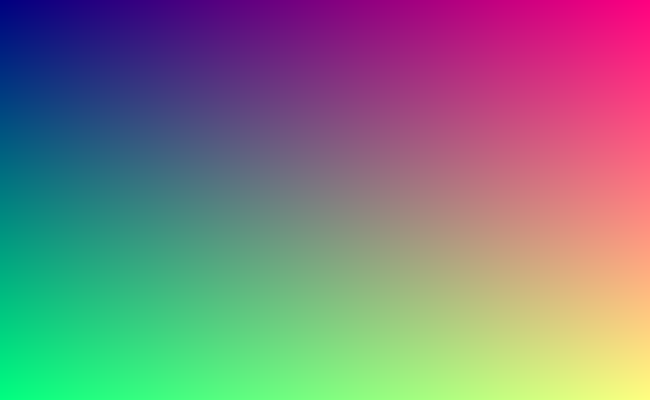
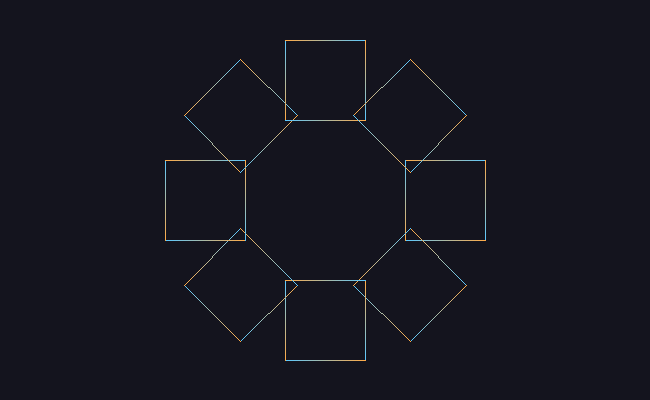
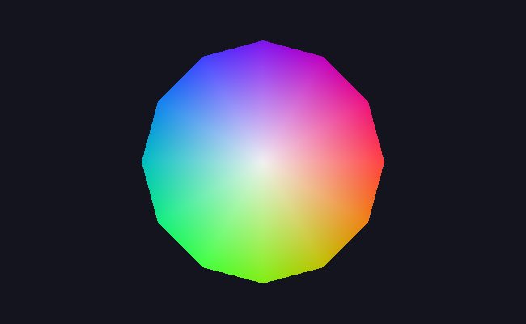
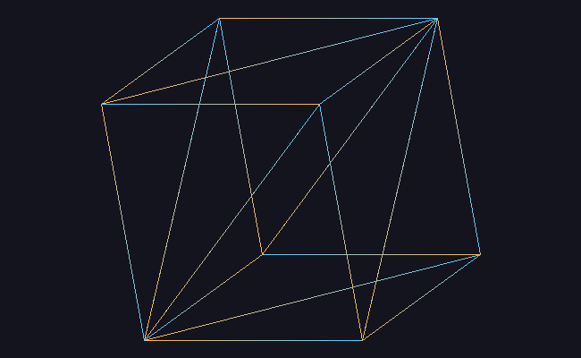
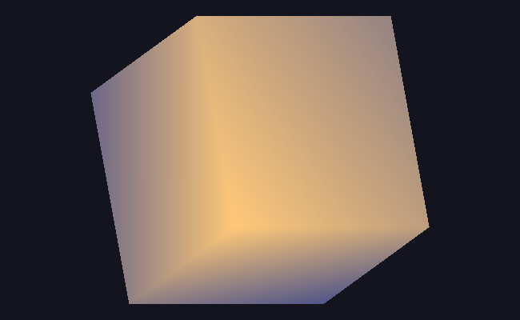

# Software Renderer

用 C++ 从零实现的软光栅化渲染器。不依赖 OpenGL 等图形库，
每一个像素都由自己计算得出。
## 效果展示

### M1 · 画布与 BMP 输出

650×400 的 24 位 BMP，纯 CPU 逐像素计算生成，未使用任何图形库。

### M2 · 向量、矩阵与线段绘制

DDA 与 Bresenham 两种画线算法，加上用齐次坐标矩阵实现的缩放、旋转、平移。

- `Vec2` / `Color`：向量与颜色基础类型，含线性插值 `lerp`
- `drawLineDDA` / `drawLineBresenham`：浮点与纯整数两种画线实现，附差分对比测试
- `Mat3`：3×3 齐次坐标矩阵，支持缩放、旋转、平移与绕任意点旋转
- 方框顶点在局部坐标中定义，经变换矩阵送入世界坐标后光栅化

### M3 · 三角形填充

12 个三角形拼成的色轮：三角形内部用重心坐标插值顶点颜色，内外用边界函数判定。

- `drawTriangle`：包围盒 + 边界函数的光栅化，支持三顶点颜色插值
- 边界函数 `edge(a, b, p)`：二维叉积，符号判定内外，数值等于面积的两倍
- 重心坐标：三个权重之和恒为 1，插值结果天然不越界
- 用三角形逼近圆形：`slices` 越大越圆滑，代价是更多填充像素

### M4 · 加载 OBJ 模型与线框渲染

从外部 OBJ 文件读入模型，经三维旋转与正交投影后渲染成线框。

- `Vec3`：三维向量类型；`Mat3` 增加绕 x / y / z 三轴的旋转
- `transformVector`：向量不受平移影响，与 `transformPoint` 区分开
- OBJ 解析：`ifstream` → `getline` → `istringstream` 三层结构；索引从 1 开始；多边形面扇形三角化
- 归一化：扫描包围盒 → 等比缩放 → 居中，任何模型都能自动适配画布

### M5 · Z-buffer 深度测试

三角形填充升级为实心渲染：每个像素记录"目前最近的深度"，逐像素比较，解决前后遮挡。另加入面法线着色与背面剔除。

- `DepthBuffer`：与画布同尺寸的深度图，`testAndSet` 实现"更近才覆盖"
- 光栅化核心重构：`ScreenVertex` 把位置/深度/颜色打包，交换顶点即交换全部属性
- 深度用重心坐标逐像素插值；面法线由叉积求得，用于着色与背面剔除
- 背面剔除让填充量减半（12 → 6 个三角形），输出逐像素不变

## 进度

- [x] M0 环境搭建 —— [笔记](docs/M0-环境搭建.md)
- [x] M1 画布与第一张图 —— [笔记](docs/M1-画布与BMP输出.md)
- [x] M2 向量、矩阵与线段绘制 —— [笔记](docs/M2-向量矩阵与线段绘制.md)
- [x] M3 三角形填充 —— [笔记](docs/M3-三角形填充.md)
- [x] M4 加载 OBJ 模型与线框渲染 —— [笔记](docs/M4-加载OBJ模型与线框渲染.md)
- [x] M5 Z-buffer 深度测试 —— [笔记](docs/M5-Z-buffer深度测试.md)
- [ ] M6 相机与投影矩阵
- [ ] M7 纹理映射
- [ ] M8 Blinn-Phong 光照
- [ ] M9 阴影
- [ ] M10 性能优化与多线程

## 构建

    cmake -S . -B build
    cmake --build build
    ./build/app
