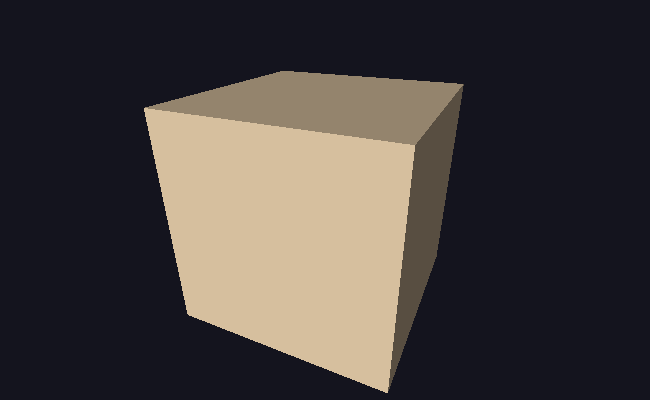
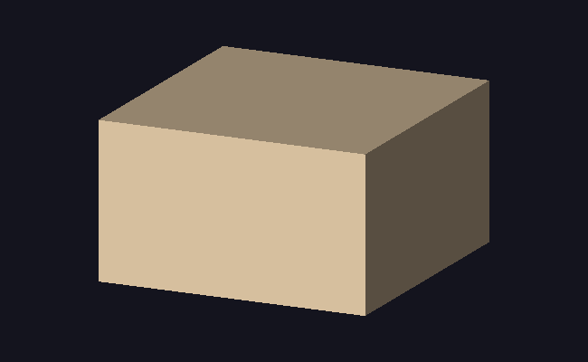

# M6 · 相机与投影矩阵

> **里程碑**：正交投影换成透视投影，画面第一次出现"近大远小"；相机成为一个可以摆放的对象。
> 前置：[M0](M0-环境搭建.md) ｜ [M1](M1-画布与BMP输出.md) ｜ [M2](M2-向量矩阵与线段绘制.md) ｜ [M3](M3-三角形填充.md) ｜ [M4](M4-加载OBJ模型与线框渲染.md) ｜ [M5](M5-Z-buffer深度测试.md)
> 逐行讲解版：[M6 详解](M6-相机与投影矩阵-详解.md)

## 目标

1. **`Vec4` 与 `Mat4`**：齐次坐标的第四个分量登场。
2. **视图矩阵 `lookAt`**：相机有位置和朝向，把世界"搬"到相机坐标系。
3. **透视投影矩阵**：`w` 变成距离，一次除法产生"近大远小"。
4. **正交投影矩阵**：用于对照，同时验证"`w = 1` 时深度必须另算"。
5. **MVP 管线与视口映射**：三个矩阵预乘一次，每个顶点一次变换，再落到画布。

## 成果

同一个相机位置、同一个模型，只有投影矩阵不同：

| 透视投影 | 正交投影 |
| --- | --- |
|  |  |

- **透视**：棱向远处收敛，顶面呈梯形，近处的竖棱明显更长，侧壁被压窄。
- **正交**：棱互相平行，顶面是平行四边形，远近等长，所有物体"一样大"。

## 实现

### 1. `Vec4` 与 `toCartesian`

```cpp
struct Vec4 { double x, y, z, w; };
inline Vec3 toCartesian(const Vec4& v) {   // 齐次 -> 笛卡尔
    return Vec3(v.x / v.w, v.y / v.w, v.z / v.w);
}
```

`toCartesian` 就是**透视除法**的正式名字：把 `(x, y, z, w)` 变成 `(x/w, y/w, z/w)`。

### 2. `Mat4`

| 函数 | 作用 |
| --- | --- |
| `identity()` | 单位矩阵 |
| `translation(tx, ty, tz)` | 平移，填第 3 列 |
| `rotationX/Y/Z(rad)` | 三个轴向旋转，本质是 3×3 旋转放进左上角 |
| `lookAt(eye, target, up)` | 视图矩阵：把世界搬到相机坐标系 |
| `perspective(fovY, aspect, near, far)` | 透视投影 |
| `orthographic(left, right, bottom, top, near, far)` | 正交投影 |

### 3. 管线

```
模型坐标 --模型矩阵--> 世界坐标 --视图矩阵--> 相机坐标 --投影矩阵--> 裁剪空间 --除以 w--> NDC --视口映射--> 画布
```

三个矩阵先乘成一个 **MVP 矩阵**，每个顶点只做一次矩阵乘：

```cpp
const Mat4 mvp = projMat * viewMat * modelMat;
const Vec4 clip = transform(mvp, Vec4(x, y, z, 1.0));
const Vec3 ndc = toCartesian(clip);
const Vec2 screen = toViewport(ndc, width, height);
```

视口映射（注意 y 翻转）：

```cpp
sx = (ndc.x * 0.5 + 0.5) * width;
sy = (0.5 - ndc.y * 0.5) * height;
```

### 4. 深度的两种语义

```cpp
v[i].depth = usePerspective ? -1.0 / clip.w : ndc.z;
```

- **透视**：屏幕空间线性的是 `1/w`（`w` 等于相机距离），取负号以满足"越小越近"；
- **正交**：`w` 恒为 1，`1/w` 是常数，深度测试会全部失效，必须改用 `ndc.z`。

### 5. 坐标系统一

面法线与光照方向必须在**同一个坐标系**里比较。模型会被旋转，所以法线要么转到世界空间，要么把光转到模型空间：

```cpp
const Mat3 rotOnly = Mat3::rotationY(modelAngle);
const Vec3 a3 = transformVector(rotOnly, model.vertices[idx[0]]);
// ... 用世界空间的三个顶点叉乘得到 n
```

如果不统一，光照会"跟着模型一起转"，看起来像物体自带了灯泡。

## 验证方式

| 测试 | 期望 |
| --- | --- |
| 单位矩阵变换点 | 不变 |
| 平移矩阵变换 `(1,2,3,1)` | `(4,6,8,1)`，`w` 仍为 1 |
| `I × T` | 与 `T` 等价 |
| 齐次 `(2,4,6,2)` 转笛卡尔 | `(1,2,3)` |
| 绕 z、y 各 90° | `(0,1,0)`、`(0,0,−1)` |
| 先转再平移 / 先平移再转 | `(3,5,5)` / `(−4,4,5)` |
| 相机在 `(0,0,5)`：原点 / 相机自身 | `(0,0,−5)` / `(0,0,0)` |
| 透视：`(1,1,−1)` 与 `(2,2,−2)` | 两者的 NDC 都是 `(1,1)`，`w` 分别为 1 和 2 |

## 踩坑记录

| 现象 | 根因 |
| --- | --- |
| 光照跟着模型转 | 法线在模型空间、光照方向在世界空间，两个坐标系不能直接点积 |
| 立方体被拉成长方体 | 正交投影的视野范围没按画布宽高比调整 |
| 正交模式下遮挡全乱 | `w` 恒为 1，`−1/w` 变成常数，深度测试失效 |
| 侧壁被压成极窄一条 | 相机太"正面"（x 相对 z 太小），应移到接近 45° 的位置 |
| 三角形出现在奇怪位置 | 顶点 `w ≤ 0`（在相机后面），除以 w 会翻转坐标，应整块跳过 |

## 运行方式

```bash
cd /mnt/hgfs/code
cmake -S . -B ~/build-renderer
cmake --build ~/build-renderer

~/build-renderer/app
~/build-renderer/tests
```

## 下一步

M7 · 纹理映射：给模型贴上图片，用重心坐标插值 UV。