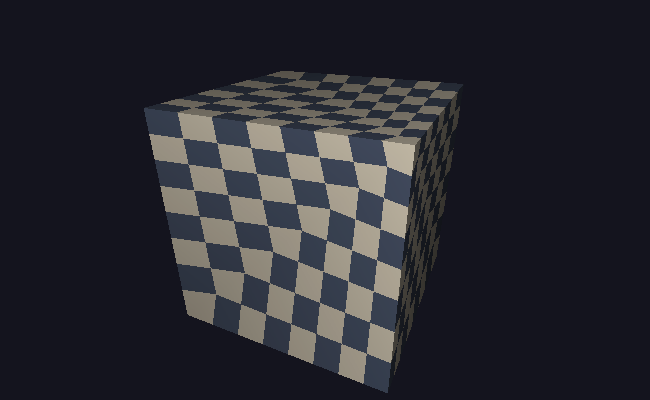
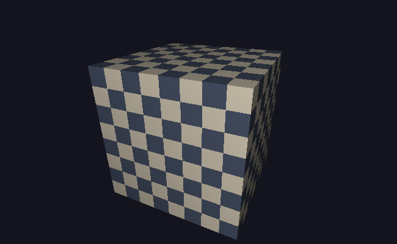

# M7 · 纹理映射

> **里程碑**：模型不再只是"有颜色的形状"，而是能贴上图片。渲染器具备了读模型、贴图、正确透视的完整能力。
> 前置：[M0](M0-环境搭建.md) ｜ [M1](M1-画布与BMP输出.md) ｜ [M2](M2-向量矩阵与线段绘制.md) ｜ [M3](M3-三角形填充.md) ｜ [M4](M4-加载OBJ模型与线框渲染.md) ｜ [M5](M5-Z-buffer深度测试.md) ｜ [M6](M6-相机与投影矩阵.md)
> 逐行讲解版：[M7 详解](M7-纹理映射-详解.md)

## 目标

把一张图片贴到三角形表面上。这一节串起了四件事：

1. **读 BMP**：把图片文件解析成内存里的像素数组（M1 的反向操作）；
2. **UV 坐标**：让每个顶点记住"贴图上哪个位置"；
3. **插值与采样**：逐像素插值 UV，再去贴图上取颜色；
4. **透视校正**：修正透视投影下纹理的扭曲。

## 成果

| 仿射插值（有扭曲与折痕） | 透视校正后 |
| --- | --- |
|  |  |

左图能看到棋盘沿着面的对角线被"鼓"出去；右图格子笔直、只按透视正常收缩。

## 实现

### 1. 贴图（`assets/checker.bmp`）

用代码生成 256×256 的 8×8 棋盘格，并用一条很轻的亮度梯度标记方向。用程序生成的好处：不依赖外部素材，且方向标记让 UV 的错误一眼可见。

### 2. `loadBMP`：读 24 位 BMP

`saveBMP` 写出去的三条规则，读的时候全部要反过来：

| 写 | 读 |
| --- | --- |
| 像素自下而上 | 文件第 0 行放进画布 `height − 1` 行 |
| 每像素写 B、G、R | 读进来是 B、G、R，放回 R、G、B |
| 行尾补齐 4 字节 | 每行读完跳过填充 |

文件头只取四个字段：像素数据偏移（10）、宽（18）、高（22）、位深（28）。入口先验证魔数 `BM`，位深不是 24 直接拒绝。

**验证方式：往返测试。** 在内存里造一张 65×33 的图（宽不是 4 的倍数 → padding 真的被用到），存盘、读回、逐像素比较，不一致数必须为 0。

### 3. OBJ 的 UV

`vt u v` 提供纹理坐标，面的写法变成 `f 1/2 3/4 5/6`（位置/UV）。解析时要：

- 收进 `Model::uvs`；
- 面里记下三个 UV 索引（`ta/tb/tc`），没有 UV 时记 `-1`。

**关键现象：立方体只有 8 个位置，却需要 24 组 UV。** 因为同一个角落在三个面上要对应贴图的不同位置——位置和 UV 不是一对一的。这正是真实模型文件里"顶点数远大于几何顶点数"的原因。

### 4. 插值与采样

`ScreenVertex` 增加 `Vec2 uv`；光栅化时用与位置、深度、颜色**同一组重心权重**插值 UV：

```cpp
const double u = w0 * v0.uv.x + w1 * v1.uv.x + w2 * v2.uv.x;
```

采样做三件事：

- **平铺**：只取 UV 的小数部分；
- **v 轴翻转**：OBJ 的 v 向上、贴图的 y 向下，`y = (1 − v) × (height − 1)`；
- **钳制**：浮点边界可能算出越界值，再夹一次。

贴图模式下最终颜色是 **贴图色 × 顶点色（亮度）**，即"调制"，得到有光照的贴图。

### 5. 透视校正

透视投影下，屏幕空间线性的是 `u/w`、`v/w`、`1/w`，而不是 `u`、`v`。所以：

```
u = Σ(weight · u_i / w_i) / Σ(weight · w_i)   // 分母是 1/w 的插值
```

`ScreenVertex` 增加 `double invW`（透视时为 `1/w`，正交时为 1）。全为 1 时公式退化成普通插值，所以 2D 与正交路径不受影响。

**深度不需要校正**：M6 特意把深度存成 `−1/w`，它本身已经是屏幕空间的线性量。

## 验证方式

| 测试 | 期望 |
| --- | --- |
| BMP 往返（65×33，含 padding） | 像素不一致数 = 0 |
| 读 checker.bmp | 256×256，左上角 R=0，右下角 R=255 |
| `cube_uv.obj` | 8 顶点 / 24 UV / 12 面，UV 索引全部合法 |
| `cube.obj`（无 UV） | UV 数 0，面的 `ta = −1` |
| 仿射 vs 校正对比 | 两张图逐字节不同 |
| 视觉检查 | 校正后格子笔直、无对角线折痕 |

## 踩坑记录

| 现象 | 根因 |
| --- | --- |
| 贴图文件提交不上去 | `.gitignore` 里的 `*.bmp` 把贴图也挡住了，需要 `!assets/*.bmp` |
| `Image img;` 编译失败 | `Image` 没有默认构造函数；读文件需要"先占位、后赋值"，补上默认构造并给成员默认值 |
| `cmp` 报"往返文件不同" | 中途用画图打开并保存过，画图会用自己的结构重写 BMP；改为"逐像素比较" |
| 贴图上下颠倒 | 采样时忘了把 v 翻转 |
| 倾斜面上纹理扭曲、有对角折痕 | 直接线性插值 UV；必须插 `u/w`、`v/w`、`1/w` 再除回来 |
| 顶面一片糊 | 走样（aliasing）：高频图案在掠射角下采样不足，需要 mipmap / 双线性过滤 |

## 运行方式

```bash
cd /mnt/hgfs/code
cmake -S . -B ~/build-renderer
cmake --build ~/build-renderer

~/build-renderer/app
~/build-renderer/tests
```

## 下一步

M8 · Blinn-Phong 光照：让材质对光有反应，出现高光和明暗过渡。